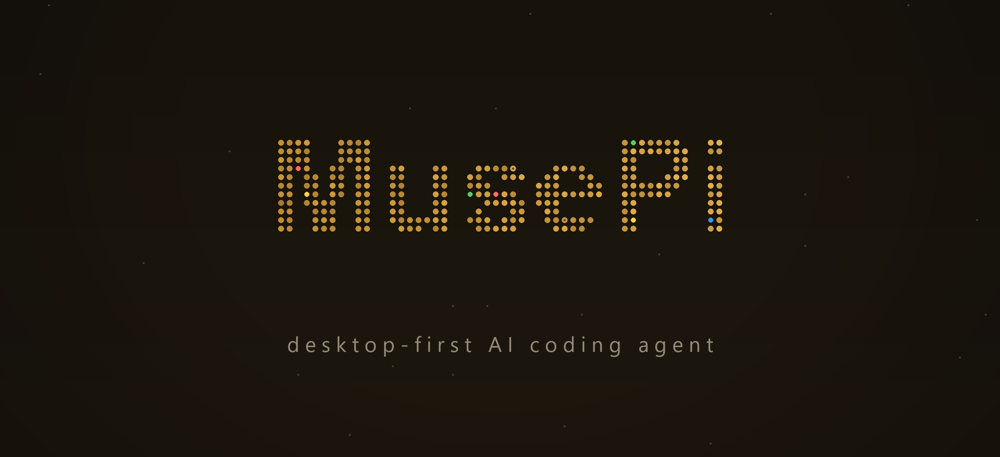
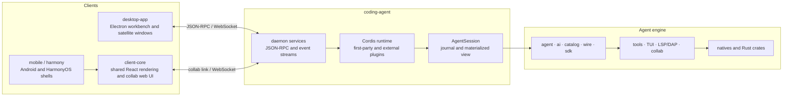

<p align="center">
  
</p>

<p align="center">
  <strong>MusePi</strong> — a desktop-first AI coding agent
</p>

<p align="center">
  <code>musepi</code> CLI · Electron desktop GUI · Cordis plugins · daemon service
</p>

<p align="center">
  <a href="https://www.npmjs.com/package/@musepi/pi-coding-agent"></a>
  <a href="https://github.com/MuseLinn/MusePi/blob/main/packages/coding-agent/CHANGELOG.musepi.md"></a>
  <a href="https://github.com/MuseLinn/MusePi/actions"></a>
  <a href="https://github.com/MuseLinn/MusePi/blob/main/LICENSE"></a>
  <a href="https://bun.sh"></a>
</p>

<p align="center">
  <em>English | <a href="README.zh-CN.md">中文</a></em>
</p>

---

MusePi combines a coding agent, an Electron workbench, a terminal UI, and remote clients. The desktop app includes an editable file workspace, review tools, a managed browser, a desktop pet, and a capability center for first-party and third-party Cordis plugins. MusePi is independently versioned; reference projects and upstream lineage are recorded in [docs/archive/upstream-lineage.md](docs/archive/upstream-lineage.md).

## Install

### Desktop, Android, and terminal downloads

Download version-matched desktop installers and Android packages from the [releases page](https://github.com/MuseLinn/MusePi/releases). The [MusePi website](https://muselinn.github.io/MusePi/) provides bilingual download guides.

- **Desktop:** macOS `.dmg`, Windows per-user `setup.exe`, Linux `.AppImage` / `.deb`.
- **Android:** install `app-debug.apk` and pair with a host on the local network.
- **Terminal:** install `musepi` with a script or from source.

macOS, Linux, and WSL:

```sh
curl -fsSL https://raw.githubusercontent.com/MuseLinn/MusePi/main/scripts/install.sh | sh
```

Windows PowerShell:

```powershell
irm https://raw.githubusercontent.com/MuseLinn/MusePi/main/scripts/install.ps1 | iex
```

From source:

```sh
git clone https://github.com/MuseLinn/MusePi.git
cd MusePi
bun run setup
bun run musepi
```

The install scripts accept `--ref <tag|commit|branch>` to select a checkout and `--source` to build instead of downloading a prebuilt binary.

## What is included

### Desktop workbench

- **Agent workspace:** session history and branching, provider-qualified model selection, slash commands, shell commands, file and session references, approvals, context compaction, and task tracking.
- **Editable files:** tabs, a non-modal file tree, Monaco-based editing, Markdown editing, document and media viewers, selection references, Git changes, issues, and pull requests.
- **Customizable shell:** theme, accent, density, liquid-glass surfaces, command palette, configurable shortcuts, right-side surfaces, terminal tabs, and a managed in-app browser.
- **Desktop companion:** animated pet, status bubbles, tray controls, and cross-window activity updates.
- **Capability center:** manage skills, plugins, and marketplace packages. Official modules and external packages use the Cordis lifecycle and shared component availability rather than separate package switches.
- **Remote access:** collaborate through encrypted links, connect remote daemon instances, and use mobile clients to manage sessions.

### Agent engine

- Multiple model providers and routing controls; LSP and DAP integration; parallel subagents; session memory; ACP; and local or remote collaboration.
- File, search, shell, code-intelligence, browser, desktop, GitHub, image, speech, memory, and skill tools. Optional tools remain controlled by settings and extension scope.
- Presets combine extension selection, prompt sections, and settings. Session presets lock after the first turn.

Detailed behavior belongs to the living documents under `docs/`, not to a feature inventory in this README.

## Architecture



| Area | Responsibility |
| --- | --- |
| `apps/desktop` | Electron shell, desktop renderer, official GUI plugins, installer and updater |
| `packages/client-core` | Shared React components, transcript, widgets, i18n, and collab web UI |
| `packages/coding-agent` | CLI, daemon (L2 host services over one RPC dispatcher), sessions, tools, bundled Cordis plugins, and extension runtime |
| `apps/mobile`, `apps/harmony` | Android and HarmonyOS shells |
| `packages/collab-proto`, `packages/wire`, `packages/sdk` | Transport, persisted contracts, and client SDK |
| `packages/agent`, `packages/ai`, `packages/catalog` | Agent loop, provider client, and model catalog |
| `packages/tui` | Terminal UI |
| `packages/utils`, `packages/natives`, `crates/` | Shared utilities and native implementations |
| `tools/` | Benchmark and harness workspaces (metaharness, TypeScript edit benchmark) |
| Other packages | Hashline edits, compaction, memory, tool selection, and statistics |

Contracts and extension boundaries: [`docs/capability-seams.md`](docs/capability-seams.md), [`docs/extensions-dev.md`](docs/extensions-dev.md), [`docs/gui-design.md`](docs/gui-design.md), and [`docs/gui-implementation.md`](docs/gui-implementation.md).

## Development

Use **Bun 1.4.4 or newer within the project compatibility policy**. Package scripts are the command source of truth.

```sh
bun run setup            # install dependencies, build natives, link the CLI
bun run build            # build workspaces that define a build script
bun run check            # TypeScript/tooling and Rust checks
bun run test             # repository test runner
bun run lint             # Biome and Rust lint
```

Useful entry points:

```sh
bun run musepi
bun --cwd=packages/coding-agent src/cli.ts serve --port 8300
bun run --cwd=apps/desktop desktop
```

Do not edit `packages/catalog/src/models.json` directly; update its generator and regenerate. Tests and smoke runs must use isolated configuration and daemon directories. See `AGENTS.md` and `.agents/rules/` for engineering and verification rules.

## Packaging and releases

`gui-release.yml` builds desktop artifacts and the Android package for version tags. Desktop releases include OTA manifests. macOS distribution requires the signing and notarization process in [`docs/macos-signing-notarization.md`](docs/macos-signing-notarization.md).

The Windows installer collects language and install options in its WebView2 wizard, checks for a running MusePi client, and then shows the real NSIS extraction progress and completion page. It does not hide a background installation behind simulated progress.

Run the release workflow only for an explicit release request. Version and changelog rules live in `.agents/rules/release.md`.

## Documentation and lineage

- [`docs/`](docs/): product and implementation documentation, with bilingual pairs where required.
- [`packages/coding-agent/CHANGELOG.musepi.md`](packages/coding-agent/CHANGELOG.musepi.md): release notes.
- [`docs/archive/upstream-lineage.md`](docs/archive/upstream-lineage.md): upstream lineage and reference-absorption history.
