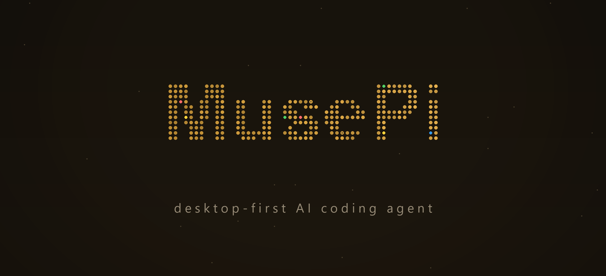
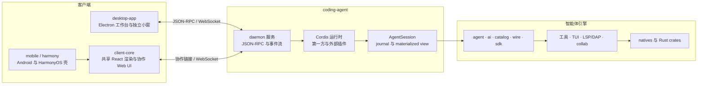

<p align="center">
  
</p>

<p align="center">
  <strong>MusePi</strong> — 桌面优先的 AI 编程助手
</p>

<p align="center">
  <code>musepi</code> CLI · Electron 桌面 GUI · Cordis 插件 · daemon 服务
</p>

<p align="center">
  <a href="https://www.npmjs.com/package/@musepi/pi-coding-agent"></a>
  <a href="https://github.com/MuseLinn/MusePi/blob/main/packages/coding-agent/CHANGELOG.musepi.md"></a>
  <a href="https://github.com/MuseLinn/MusePi/actions"></a>
  <a href="https://github.com/MuseLinn/MusePi/blob/main/LICENSE"></a>
  <a href="https://bun.sh"></a>
</p>

<p align="center">
  <em><a href="README.md">English</a> | 中文</em>
</p>

---

MusePi 集编程智能体、Electron 工作台、终端界面和远程客户端于一体。桌面端提供可编辑文件工作区、代码审阅工具、受管浏览器、桌宠，以及管理第一方和第三方 Cordis 插件的能力中心。MusePi 独立发版；参考项目与上游沿革记录在 [docs/archive/upstream-lineage.md](docs/archive/upstream-lineage.md)。

## 安装

### 桌面、Android 与终端下载

从 [Releases 页面](https://github.com/MuseLinn/MusePi/releases)下载与版本匹配的桌面安装包和 Android 软件包。[MusePi 官网](https://muselinn.github.io/MusePi/)提供双语下载指引。

- **桌面端：** macOS `.dmg`、Windows 逐用户 `setup.exe`、Linux `.AppImage` / `.deb`。
- **Android：** 安装 `app-debug.apk`，再与局域网内的主机配对。
- **终端：** 通过脚本或源码安装 `musepi`。

macOS、Linux 和 WSL：

```sh
curl -fsSL https://raw.githubusercontent.com/MuseLinn/MusePi/main/scripts/install.sh | sh
```

Windows PowerShell：

```powershell
irm https://raw.githubusercontent.com/MuseLinn/MusePi/main/scripts/install.ps1 | iex
```

从源码安装：

```sh
git clone https://github.com/MuseLinn/MusePi.git
cd MusePi
bun run setup
bun run musepi
```

安装脚本支持 `--ref <tag|commit|branch>` 选择指定版本，支持 `--source` 从源码构建而非下载预编译二进制。

## 主要能力

### 桌面工作台

- **智能体工作区：** 会话历史与分支、使用 `provider/id` 的模型选择、斜杠命令、Shell 命令、文件与会话引用、审批、上下文压缩和任务跟踪。
- **可编辑文件：** 标签页、非模态文件树、Monaco 编辑、Markdown 编辑、文档与媒体查看、选区引用、Git 变更、问题和拉取请求。
- **可定制界面：** 主题、强调色、密度、液态玻璃表面、命令面板、可配置快捷键、右侧面板、终端标签页和受管内置浏览器。
- **桌面伙伴：** 动画桌宠、状态气泡、托盘控制和跨窗口活动更新。
- **能力中心：** 管理技能、插件和市场软件包。官方模块与外部软件包共用 Cordis 生命周期和组件可用性，不维护第二套软件包开关。
- **远程访问：** 通过加密链接协作、连接远程 daemon 实例，并使用移动客户端管理会话。

### 智能体引擎

- 支持多家模型供应商与路由控制，集成 LSP、DAP、并行子智能体、会话记忆、ACP，以及本地或远程协作。
- 提供文件、搜索、Shell、代码智能、浏览器、桌面、GitHub、图像、语音、记忆和技能工具。可选工具由设置与扩展范围控制。
- 预设组合扩展选择、提示词段落和设置。会话预设会在首轮后锁定。

具体行为由 `docs/` 下的活文档说明，本 README 不重复维护完整功能清单。

## 架构



| 区域 | 职责 |
| --- | --- |
| `apps/desktop` | Electron 壳、桌面渲染端、官方 GUI 插件、安装器与更新器 |
| `packages/client-core` | 共享 React 组件、转录、widget、i18n 和协作 Web UI |
| `packages/coding-agent` | CLI、daemon、会话、工具、内置 Cordis 插件和扩展运行时 |
| `apps/mobile`、`apps/harmony` | Android 与 HarmonyOS 壳 |
| `packages/collab-proto`、`packages/wire`、`packages/sdk` | 传输、持久化契约和客户端 SDK |
| `packages/agent`、`packages/ai`、`packages/catalog` | 智能体循环、供应商客户端和模型目录 |
| `packages/tui` | 终端界面 |
| `packages/utils`、`packages/natives`、`crates/` | 共享工具与原生实现 |
| 其他包 | Hashline 编辑、压缩、记忆、工具选择、统计和测试工具 |

契约与扩展边界见 [`docs/capability-seams.md`](docs/capability-seams.md)、[`docs/extensions-dev.md`](docs/extensions-dev.md)、[`docs/gui-design.md`](docs/gui-design.md) 和 [`docs/gui-implementation.md`](docs/gui-implementation.md)。

## 开发

使用 **Bun 1.4.4 或项目兼容策略允许的新版本**。各包的 `package.json` scripts 是命令依据。

```sh
bun run setup            # 安装依赖、构建 natives、链接 CLI
bun run build            # 构建定义了 build script 的工作区
bun run check            # TypeScript／工具链与 Rust 检查
bun run test             # 仓库测试运行器
bun run lint             # Biome 与 Rust lint
```

常用入口：

```sh
bun run musepi
bun --cwd=packages/coding-agent src/cli.ts serve --port 8300
bun run --cwd=apps/desktop desktop
```

不要直接编辑 `packages/catalog/src/models.json`；应修改生成器并重新生成。测试与冒烟运行必须使用隔离的配置和 daemon 目录。工程与验证规则见 `AGENTS.md` 和 `.agents/rules/`。

## 打包与发布

`gui-release.yml` 在版本标签上构建桌面工件和 Android 软件包，桌面发布包含 OTA 清单。macOS 分发需要遵循 [`docs/macos-signing-notarization.md`](docs/macos-signing-notarization.md) 中的签名与公证流程。

Windows 安装器先在 WebView2 向导中收集语言与安装选项，检查 MusePi 客户端是否正在运行，再显示真实的 NSIS 文件释放进度和完成页，不会用模拟进度掩盖后台安装。

只有明确要求发布时才运行发布流程。版本与更新日志规则见 `.agents/rules/release.md`。

## 文档与沿革

- [`docs/`](docs/)：产品与实现文档，按要求维护中英双语配对。
- [`packages/coding-agent/CHANGELOG.musepi.md`](packages/coding-agent/CHANGELOG.musepi.md)：发布说明。
- [`docs/archive/upstream-lineage.md`](docs/archive/upstream-lineage.md)：上游沿革与参考吸收历史。
